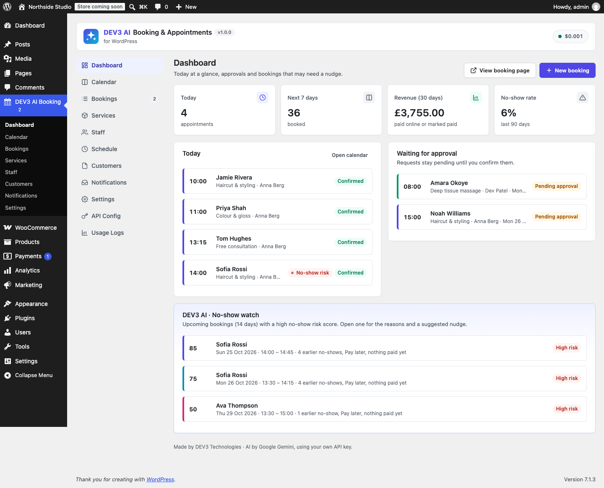

# DEV3 AI Booking & Appointments for WordPress

Appointment booking with services, staff, schedules, payments, reminders, an admin calendar and DEV3 AI natural-language booking.



## Features

* Services with duration, price, deposits, group capacity, buffers, notice and advance limits.
* Staff with their own time zones, weekly hours, breaks, time off, special days and a private iCal feed.
* Business hours, closures and yearly holidays. DST-safe availability with customer time zones.
* Mobile-first booking widget (Gutenberg block + [dev3bk_booking] shortcode).
* Payments: pay at the appointment, Stripe Checkout (webhooks, refunds) and WooCommerce checkout (HPOS + block checkout).
* Customer area ([dev3bk_my_bookings]) with reschedule and cancel policies.
* Emails, reminders and follow-ups from editable templates, .ics files and Google Calendar links.
* Admin calendar (day, week, month), bookings list with CSV export, customers.
* DEV3 AI (Google AI, your own key): natural-language booking that returns only real free slots, AI-written reminder copy you approve, and a no-show risk hint.

## Requirements

- WordPress 6.0 or newer (tested up to 6.8)
- PHP 7.4 or newer
- WooCommerce 8.0 or newer (optional integration)
- Optional: your own Google AI API key (from Google AI Studio) to switch on the DEV3 AI features. The rest of the plugin works without one.

## Installation

### From the release zip

1. Download `dev3-ai-booking-appointments.zip` from the [latest release](https://github.com/dev3tech/dev3-ai-booking-appointments/releases/latest).
2. In WordPress, go to **Plugins → Add New → Upload Plugin**, choose the zip and click **Install Now**.
3. Click **Activate**.

### Build from source

```bash
git clone https://github.com/dev3tech/dev3-ai-booking-appointments.git
cd dev3-ai-booking-appointments
composer install --no-dev
npm ci
npm run build
```

Then copy the `dev3-ai-booking-appointments` folder into `wp-content/plugins/` and activate it.

### Getting started

1. Upload the zip in Plugins › Add New › Upload Plugin and activate.
2. Open DEV3 AI Booking: add services, staff and hours.
3. The "Book an appointment" and "My bookings" pages are created for you.
4. Optional: add your Google AI API key in API Config.

## FAQ

### Does it need WooCommerce?
No. WooCommerce is only used for checkout payments if you turn it on.

### Does it work without AI?
Yes. Every feature works without a key.

## Privacy

When DEV3 AI is enabled, the booking request text typed by customers, email template text and anonymised booking facts are sent to Google AI. Customer data is included in WordPress's personal data export and erase tools.

## Documentation

The full HTML guide (installation, settings, hooks and FAQ) is in [`docs/index.html`](docs/index.html). Open it in a browser after cloning or downloading the repository.

## Changelog

### 1.0.0
* Initial release.

## Licence

Released under the GNU General Public License v2.0 or later (GPL-2.0-or-later). See [LICENSE](LICENSE).

## More from DEV3

- [DEV3 AI Booking & Appointments for WordPress on the DEV3 Marketplace](https://www.dev3.tech/item/dev3-ai-booking-appointments)
- [More WordPress plugins, themes and templates from DEV3](https://www.dev3.tech/marketplace)
